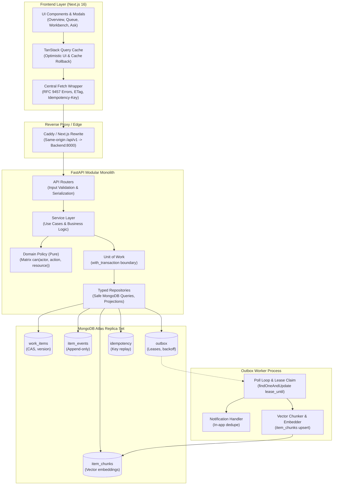
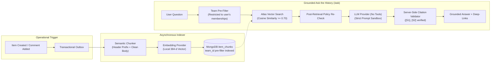

# Opsboard: Operations Under Pressure

An enterprise operational mission control system engineered for high-concurrency request triage, incident coordination, multi-team approvals, and immutable audit history. Built for the **Newtonite Software Engineering Challenge**.

**Stack:**
- **Backend:** Python 3.12 · FastAPI · Pydantic v2 · **PyMongo Async API (`AsyncMongoClient`)** (no ODM, no Motor).
- **Database:** MongoDB Atlas (Replica Set, Multi-Document Transactions, Atlas Search & Vector Search).
- **Worker:** Standalone async process executing outbox messages (notifications, embedding indexing).
- **Frontend:** Next.js 16 (App Router) · TypeScript · TanStack Query v5 · Tailwind CSS · React Hook Form · Zod.
- **AI/RAG:** Hand-rolled authorization-aware retrieval with vector pre-filtering, server-side citation validation, and offline zero-cost fallback.

---

## Table of Contents
1. [Executive Summary & Problem Statement](#executive-summary--problem-statement)
2. [Architecture Blueprint](#architecture-blueprint)
3. [The 7 Critical Concurrency & Consistency Behaviors](#the-7-critical-concurrency--consistency-behaviors)
4. [AI & Grounded RAG Architecture](#ai--grounded-rag-architecture)
5. [Error Handling Architecture (RFC 7807 / 9457)](#error-handling-architecture-rfc-7807--9457)
6. [Quick Start & How to Run](#quick-start--how-to-run)
7. [Demo Accounts & Interactive Walkthrough](#demo-accounts--interactive-walkthrough)
8. [Automated Verification & Tests](#automated-verification--tests)
9. [Documentation Sitemap](#documentation-sitemap)

---

## Executive Summary & Problem Statement

Growing companies experience operational breakdown when coordinating high-stakes requests (production incidents, high-value refunds, customer escalations, compliance reviews) through fragmented chat threads, spreadsheets, and emails:
- **Ownership collisions:** Multiple operators claim the same incident simultaneously, creating duplicate efforts or dropped context.
- **Stale overwrites:** Operator A edits an older snapshot while Operator B changes priority or status, silently losing critical updates.
- **Lost actions:** Requests get lost in long message threads; side effects fail silently during system hiccups.
- **Compliance & approval failures:** Unchecked single-operator actions lead to fraudulent or unreviewed high-value payouts.
- **Information silos:** Historical operational knowledge is trapped across silos, making it difficult to answer *"how was this resolved last month?"*

**Opsboard replaces this failure mode** with an institutional-grade system founded on database-level concurrency primitives, transactional side effects, strict resource-level authorization, and team-isolated semantic retrieval.

---

## Architecture Blueprint



### Architectural Layering Rules (Strictly Enforced)
1. **Routers:** Parse and validate HTTP inputs; call exactly one service method; return standard response models. Contain **zero business logic**.
2. **Services:** Orchestrate business use cases; invoke pure domain rules (`policy`, `workflow`); execute multi-document mutations inside `UnitOfWork.run(with_transaction)`.
3. **Domain:** Pure Python modules (`policy.py`, `workflow.py`, `attention.py`). Performs **zero I/O** or database access; 100% unit testable in milliseconds.
4. **Repositories:** The only code permitted to touch collections. Queries are constructed exclusively from typed parameters (never raw request dictionaries).
5. **Bounded Reads:** Keyset pagination on every list endpoint (opaque cursors, maximum limit 100). No unbounded memory loading or full-collection scans (all 9 core queries verified as `IXSCAN`).

---

## The 7 Critical Concurrency & Consistency Behaviors

The system delivers deliberate engineering guarantees for 7 non-trivial operational challenges:

### 1. Atomic Claim Race (Single Winner)
- **Problem:** Two operators viewing an unassigned urgent item click *Claim* at the exact same millisecond.
- **Solution:** Atomic Compare-And-Set (`find_one_and_update`) requiring `{assignee_id: None, status: "open"}` in the filter query. The database enforces exactly one winner. The loser immediately receives `409 Conflict` (`ALREADY_CLAIMED`) containing the winner's identity, triggering an optimistic UI rollback.

### 2. Stale Writes & Optimistic Concurrency Control
- **Problem:** Operator A views an item and submits a change while Operator B has already modified the item's priority or status.
- **Solution:** Every mutating `PATCH` or workflow transition requires an `If-Match: "<version>"` header matching the item document's integer `version`. If mismatched, the server rejects the write with `412 Precondition Failed` (`VERSION_CONFLICT`), returning the server's current state and all audit events that occurred since the client's version. The client displays a visual conflict reconciliation dialog without losing drafts.
- *Invariant:* Comments do not bump `version`, so team discussions never invalidate in-flight edits.

### 3. Transactional Idempotency
- **Problem:** An operator clicks *Create* or *Approve* during network instability, experiences a timeout, and re-submits the request.
- **Solution:** Mutating endpoints require an `Idempotency-Key` header. The request fingerprint and cached response are persisted inside the `idempotency` collection **in the same MongoDB transaction** as the business mutation. A retry re-serves the cached `201`/`200` response with identical headers without creating duplicate work items.

### 4. Transactional Outbox & Reliable Async Side Effects
- **Problem:** Secondary side effects (in-app notifications, search indexing, vector embedding) must never be lost if a process crashes, nor cause dual-write divergence if a database transaction aborts.
- **Solution:** Every state change, audit timeline event, and outbox job commit together inside `UnitOfWork.run(...)`. A separate worker process polls the outbox using atomic lease claims (`lease_until`), exponential backoff with jitter, and dead-lettering after 6 failed attempts. Handlers are strictly idempotent using deterministic dedupe keys.

### 5. Resource-Level Authorization & Stealth Cross-Team Isolation
- **Problem:** A user belonging to one team must not view or mutate another team's private operational incidents or approvals.
- **Solution:** All access passes through `policy.can(actor, action, resource)`. If a user attempts to fetch or mutate an item outside their authorized team memberships, the API returns **`404 Not Found`** rather than `403 Forbidden`, preventing resource enumeration or existence leakage.

### 6. Four-Eyes Approval Invariant
- **Problem:** High-value operational requests (e.g., SLA refund >$10,000) must require secondary authorization to prevent fraud or unilateral error.
- **Solution:** The state machine transitions high-value items into `pending_approval`. `policy.can(...)` strictly forbids the requester from approving their own request (`requester_id != approver_id`). Only team leads or authorized peers can decide the approval.

### 7. Append-Only Audit History
- **Problem:** Operational disputes require an indisputable record of who changed what, when, and why.
- **Solution:** Every state transition, comment, reassignment, and approval decision writes an immutable event into `item_events` with an incrementing `event_seq`. The collection has **no update or delete code paths**.

---

## AI & Grounded RAG Architecture

The AI layer is intentionally designed as an **authorization-aware, grounded operational assistant** rather than an autonomous or tool-wielding agent.



### 1. Semantic Chunking Strategy
Rather than arbitrary fixed-character sliding windows, text is chunked by **operational semantic units**:
- **Item Chunk:** Item Key, Title, Category, Priority, and initial Description.
- **Event / Comment Chunk:** Item Key, Author, Timestamp, and Comment Body.
- **Resolution / Decision Chunk:** Item Key, Resolver, Decision Reason, and Approver note.
Every chunk prepends a structured context header:
```text
[ITEM-PAY-101] Title: Double charge on checkout | Team: Payments | Category: payment
Customer was debited twice during card processing spike...
```

### 2. Tenant-Isolated Retrieval
Before vector search executes, the query enforces a mandatory pre-filter on `team_id`:
```python
pipeline = [
    {
        "$vectorSearch": {
            "index": "vector_index",
            "path": "embedding",
            "queryVector": query_vector,
            "numCandidates": 50,
            "limit": 5,
            "filter": {"team_id": {"$in": user_team_ids}},
        }
    }
]
```
Data belonging to teams the user is not a member of **never enters the retrieval pool and never reaches the LLM prompt**.

### 3. Server-Side Citation Validation
The LLM is prompted with delimited sources (`[S1]`, `[S2]`) and forbidden from using outside knowledge. The backend parses all returned citation markers and cross-references them against the retrieved passage keys. Hallucinated citations are discarded, and valid citations are enriched with direct item workbench links.

### 4. Pluggable Providers & Zero-Cost Offline Fallback
- **`FakeEmbeddingProvider` (Default):** Deterministic 384-dimensional unit vectors generated via SHA-256 token hashing with term-frequency weighting. Fast, 100% offline, zero-cost, zero-API-key. Passes the evaluation golden set with 100% Recall@5 and 1.0 MRR.
- **`FastembedProvider`:** Local ONNX CPU embedding via `fastembed` (`BAAI/bge-small-en-v1.5`).
- **`AnthropicProvider` / `OpenAIProvider`:** Pluggable adapters for live synthesis (`claude-3-5-sonnet`, `gpt-4o-mini`, or any OpenAI-compatible base URL).
- **Graceful Degradation:** If `AI_ENABLED=true` but no LLM API key is provided, the API degrades gracefully (`degraded: true`), returning authoritative retrieved vector passages without raising application errors.

---

## Error Handling Architecture (RFC 7807 / 9457)

All error responses strictly adhere to the **RFC 9457 Problem Details** standard. Internal stack traces or database driver exceptions are never leaked to clients.

### Problem Details Schema
```json
{
  "type": "https://opsboard.dev/errors/already-claimed",
  "title": "Item Already Claimed",
  "status": 409,
  "detail": "Item PAY-101 was already claimed by Priya Lead.",
  "code": "ALREADY_CLAIMED",
  "meta": {
    "claimed_by_id": "usr_99182",
    "claimed_by_name": "Priya Lead",
    "item_key": "PAY-101"
  },
  "request_id": "req_01HP8M9K4N2P3Q"
}
```

### Machine-Readable Error Code Catalog

| HTTP Status | Error Code | Description & Client Handling |
|---|---|---|
| `400` | `BAD_CURSOR` | Malformed pagination cursor; client restarts pagination from beginning. |
| `400` | `INVALID_TRANSITION` | Transition forbidden by state machine; client refreshes available actions. |
| `400` | `FOUR_EYES_VIOLATION` | Requester attempted to approve own request; client disables approve button. |
| `401` | `UNAUTHENTICATED` | Session missing or expired; client redirects to `/login`. |
| `403` | `FORBIDDEN` | Insufficient team role permissions for action. |
| `404` | `ITEM_NOT_FOUND` | Item does not exist or caller is not a member of the owning team. |
| `409` | `ALREADY_CLAIMED` | Concurrent claim race lost; client rolls back optimistic claim and shows winner. |
| `409` | `IDEMPOTENCY_MISMATCH`| `Idempotency-Key` replayed with different request body or URL. |
| `412` | `VERSION_CONFLICT` | Stale edit detected; client displays diff reconciliation dialog. |
| `429` | `RATE_LIMITED` | Rate limit exceeded (e.g. AI ask quota); client shows retry timer. |

---

## Quick Start & How to Run

### Prerequisites
- **Option 1 (Docker):** Docker Desktop / Docker Compose.
- **Option 2 (Native):** Python 3.12, Node.js 20+, and MongoDB replica set (local or Atlas).

### Option A: Running via Docker Compose
```bash
# 1. Clone repository and copy sample environment
git clone <repo-url> && cd Newtonite
cp .env.example .env

# 2. Start full stack (MongoDB Atlas Local, FastAPI backend, outbox worker, Next.js web)
make up-local

# 3. Ensure indexes and populate demo dataset
make indexes
make seed

# 4. Open in browser
open http://localhost:3000
```

### Option B: Running Locally (Native Development)

#### 1. Setup Backend
```bash
cd backend
python -m venv .venv
# Windows: .venv\Scripts\activate | Linux/macOS: source .venv/bin/activate
pip install -r requirements.txt

# Ensure .env is populated with your MongoDB replica set URI:
# MONGODB_URI=mongodb+srv://<user>:<password>@cluster0.xxx.mongodb.net/?retryWrites=true&w=majority

# Initialize database indexes
python -c "import asyncio; from app.db.client import mongo_manager; from app.db.indexes import ensure_indexes; async def r(): await mongo_manager.connect(); await ensure_indexes(mongo_manager.get_database()); await mongo_manager.close(); asyncio.run(r())"

# Seed demo dataset with realistic items across 6 challenge categories
python seed.py

# Start API Server (Port 8000)
python -m uvicorn app.main:app --host 127.0.0.1 --port 8000 --reload

# Start Outbox Worker (Separate terminal)
python -m app.worker
```

#### 2. Setup Frontend
```bash
cd frontend
npm install
npm run dev

# Open frontend in browser
open http://localhost:3000
```

---

## Demo Accounts & Interactive Walkthrough

All seeded demo accounts share the password **`Password123!`**. Quick-login buttons are built directly into the `/login` screen.

| User | Email | Role & Team Memberships | Demo Purpose |
|---|---|---|---|
| **Alice Admin** | `admin@opsboard.dev` | Org Admin (Global access across all teams) | Cross-team visibility, system oversight |
| **Priya Lead** | `lead@opsboard.dev` | Payments (Lead), Compliance (Lead), Eng (Member) | Demonstrates four-eyes approval decisions across teams |
| **Marcus Member** | `member@opsboard.dev` | Payments (Member), Engineering (Lead) | Item claims, approval requests, lead in Eng |
| **Sarah Contender** | `member2@opsboard.dev` | Payments (Member) | Contender for concurrent claim and edit races |
| **Victor Viewer** | `viewer@opsboard.dev` | Payments (Viewer) | Read-only enforcement; mutations blocked by policy |

### 7-Step Interactive Verification Walkthrough

1. **Test Claim Race (Item `PAY-101`):**
   - Open two browser sessions (e.g., Chrome & Incognito).
   - Log in as **Marcus Member** in Window 1 and **Sarah Contender** in Window 2.
   - Navigate to `/items/PAY-101` (Unassigned Urgent double-charge incident).
   - Click **Claim** simultaneously on both windows.
   - **Result:** One operator wins cleanly. The second receives `409 Conflict` stating *"Claimed by Marcus Member a moment ago"* with an immediate state reconciliation.
2. **Test Stale Edit & Conflict Dialog (Item `PAY-103`):**
   - Open `/items/PAY-103` in both browser windows.
   - In Window 1, update priority from `P2` to `P1` and save.
   - In Window 2 (without refreshing), edit the description and click **Save**.
   - **Result:** Window 2 receives `412 Precondition Failed` and renders a conflict reconciliation dialog showing the server's current values and recent changes, keeping the user's draft intact.
3. **Test Retry Safety & Idempotency:**
   - Create an item via API or UI with header `Idempotency-Key: retry-test-01`.
   - Replay the identical request.
   - **Result:** Returns the exact same HTTP 201 response and item key; no duplicate document is inserted in MongoDB.
4. **Test Four-Eyes Approval Enforcement (Item `PAY-102`):**
   - Log in as **Marcus Member** and open `/items/PAY-102` ($15,000 refund request in `pending_approval`).
   - Notice the approval buttons are disabled: Marcus requested this item, so `policy.can(...)` prohibits self-approval.
   - Switch user to **Priya Lead**. The decision panel is enabled: Priya approves the refund.
5. **Test Stealth Cross-Team Isolation (404 Not Found):**
   - Log in as **Victor Viewer** (member of Payments only).
   - Attempt to navigate directly to `/items/ENG-201` (Core Engineering incident).
   - **Result:** The server returns `404 Not Found` (never 403), protecting confidential cross-team operations from existence discovery.
6. **Test Outbox Fault Tolerance:**
   - Stop the outbox worker process.
   - Create work items and add comments in the UI.
   - Check the database: state changes and audit events are committed, and jobs are safely queued in `outbox`.
   - Restart `python -m app.worker`: the worker claims jobs with atomic leases and catches up within seconds.
7. **Test Grounded AI "Ask the History" (`/ask`):**
   - Navigate to `/ask` in the navigation bar.
   - Click the chip: *"What customer was double charged on checkout during the card processing spike?"*
   - **Result:** The system executes team-filtered vector search and returns a synthesized answer with exact grounded citations and deep-links to `PAY-101`.

---

## Automated Verification & Tests

The test suite validates critical operational invariants against **real MongoDB**, never mocks.

```bash
# Run all 116 unit and integration tests
make test

# Verify query index usage (IXSCAN vs COLLSCAN report)
make explain

# Run retrieval accuracy evaluation on golden set
make eval

# Complete verification check (test + explain + eval)
make check
```

### Test Suite Summary (116/116 Passing)
- `tests/test_domain_models.py` (13/13): Enums, SLA due date calculations, attention triggers.
- `tests/test_policy.py` (46/46): Exhaustive authorization matrix covering all roles, actions, and ownership.
- `tests/test_workflow.py` (35/35): State machine transitions, guards, resolution validation.
- `tests/test_integration_concurrency.py` (4/4): Atomic claim races, multi-document transactions, optimistic locking.
- `tests/test_outbox_worker.py` (5/5): Lease expiration, exponential backoff, dead-letter queue, idempotency.
- `tests/test_search_and_pagination.py` (5/5): Opaque keyset cursor pagination, bounded queries.
- `tests/test_ai.py` (8/8): Multi-team vector isolation, server-side citation validation, degraded offline fallback.

### Query Index Usage Report (`make explain`)
All 9 critical production queries execute via indexed B-Tree scans (`IXSCAN`) with **zero collection scans (`COLLSCAN`)**:
1. Lookup item by `(team_id, key)`: `IXSCAN`
2. Keyset pagination by `(team_id, priority, updated_at, _id)`: `IXSCAN`
3. Overdue / SLA attention scan: `IXSCAN`
4. Assignee workload query: `IXSCAN`
5. Item timeline events query: `IXSCAN`
6. Pending approval uniqueness lookup: `IXSCAN`
7. Outbox worker poll: `IXSCAN`
8. In-app unread notifications: `IXSCAN`
9. RAG chunk vector pre-filter scan: `IXSCAN`

### Retrieval Evaluation Benchmark (`make eval`)
Evaluated against [`eval/golden_set.json`](eval/golden_set.json):
- **Recall@1:** `100.00%`
- **Recall@5:** `100.00%` (Target: >= 80%)
- **MRR (Mean Reciprocal Rank):** `1.0000`
- **Status:** **PASSED** (Written to [`backend/eval/results/latest.md`](backend/eval/results/latest.md))

---

## Documentation Sitemap

| Specification Document | Contents & Engineering Purpose |
|---|---|
| [`docs/SYSTEM_DESIGN.md`](docs/SYSTEM_DESIGN.md) | Complete system architecture, design patterns, lifecycle state machines, security, and scaling paths. |
| [`docs/DATA_MODEL.md`](docs/DATA_MODEL.md) | Detailed MongoDB schema design, collection invariants, and compound index specifications. |
| [`docs/API_SPEC.md`](docs/API_SPEC.md) | The HTTP REST contract, OpenAPI specifications, headers, and RFC 9457 error code catalog. |
| [`docs/ENGINEERING_DECISIONS.md`](docs/ENGINEERING_DECISIONS.md) | Analysis of 5 major architectural choices, alternatives rejected, and trade-offs accepted. |
| [`docs/KNOWN_LIMITATIONS.md`](docs/KNOWN_LIMITATIONS.md) | Explicit scope boundaries, intentional omissions, scale boundaries, and next-week backlog. |
| [`docs/TEST_PLAN.md`](docs/TEST_PLAN.md) | Risk-driven testing strategy, test IDs (`T-CLM-1`, `T-VER-1`), and verification matrix. |
| [`docs/IMPLEMENTATION_PLAN.md`](docs/IMPLEMENTATION_PLAN.md) | Phased delivery schedule, day-0 risk checklist, and build sequences. |
| [`docs/REVIEW_PREP.md`](docs/REVIEW_PREP.md) | Comprehensive walkthrough script, failure scenarios, and candidate interview defense sheet. |
