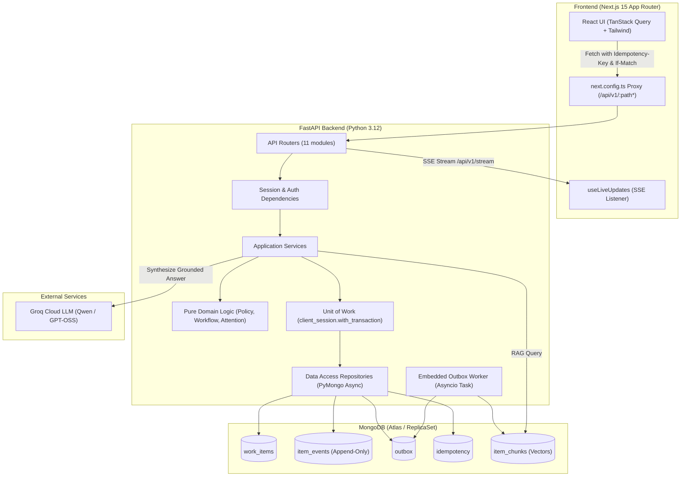
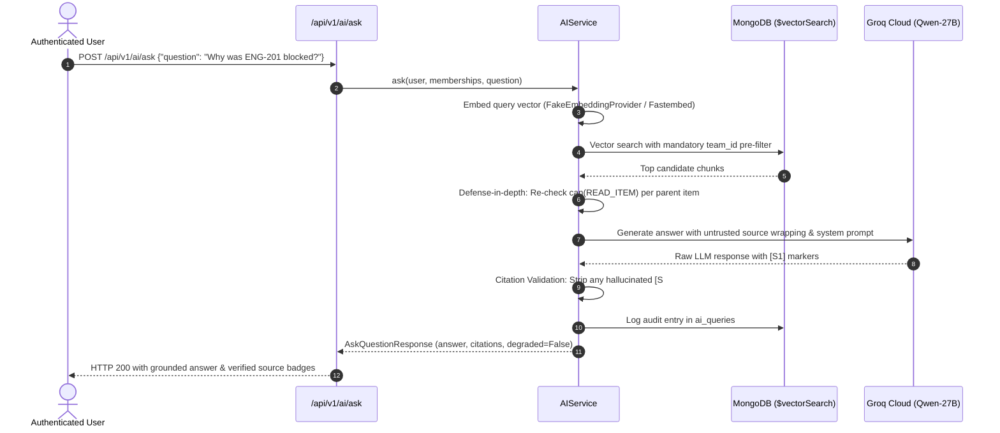

# Opsboard: Comprehensive Interview & Architecture Guide

This document is your complete preparation sheet for the technical walkthrough and interview for the **Newtonite Software Engineering Challenge**. It details the business problem, architectural patterns, end-to-end request flows, an exhaustive file-by-file breakdown, critical concurrency primitives, and model answers to tough interview questions.

---

## 1. Executive Summary & Pitch

### The Problem
A fast-growing company coordinates operational work (customer issues, engineering incidents, payment discrepancies, compliance tasks) across multiple teams via email, Slack threads, and spreadsheets. 
- Critical issues get lost in message threads.
- Two people begin working on the same issue simultaneously without realizing it (claim race).
- Multiple users overwrite each other's edits with stale data (lost updates).
- Approvals lack audit trails and separation of duties (people approve their own requests).
- Management lacks a consolidated view of what is urgent, overdue, or blocked.

### The Solution: Opsboard
**Opsboard** is an internal operational command center built with **FastAPI**, **PyMongo Async API**, **MongoDB**, and **Next.js 15 (App Router)**.
- **Zero-Collision Concurrency:** Atomic compare-and-set (`find_one_and_update`) ensures exactly one winner in simultaneous claim races. Optimistic locking via `If-Match: "<version>"` prevents stale overwrites.
- **Strict Separation of Duties (Four-Eyes Principle):** Requesters are blocked at the domain level from approving their own critical operational changes.
- **Transactional Outbox & Audit Ledger:** Every state mutation appends an immutable event to `item_events` and enqueues background jobs in `outbox` within the **same ACID transaction** (`with_transaction`).
- **Grounded AI Assistant:** Integrated with **Groq Cloud** (`qwen/qwen3.8-27b`). Vector retrieval strictly pre-filters by the caller's authorized teams, validates citation markers (`[S1]`, `[S2]`), and degrades to raw passages if the LLM is unavailable.
- **Bounded Performance:** Keyset pagination on compound indexes; zero collection scans (`COLLSCAN`); zero unbounded in-memory array loads.

---

## 2. High-Level Architecture & Request Flow



### End-to-End Request Flow (e.g., Claiming an Item)
1. **Client Action:** Marcus clicks "Claim" on ticket `PAY-101`.
2. **TanStack Query Mutation:** 
   - Generates a UUID `Idempotency-Key`.
   - Sends `POST /api/v1/items/PAY-101/claim`.
3. **Vercel / Next.js Rewrite:** Next.js proxies `/api/v1/items/PAY-101/claim` to the FastAPI backend.
4. **FastAPI Middleware & Dependencies (`deps.py`):**
   - Extracts session cookie `opsboard_session`.
   - Validates session in `sessions` collection and resolves user + memberships.
5. **Item Service (`item_service.py`):**
   - Calls pure domain policy: `can(actor, Action.CLAIM_ITEM, resource)`.
   - Verifies caller has `MEMBER` or `LEAD` role in the item's team.
6. **Unit of Work & Atomic CAS (`uow.py` + `items.py`):**
   - Enters `UnitOfWork.run(db)`.
   - Executes `find_one_and_update` on `work_items` with filter:
     `{"_id": item_id, "assignee_id": None}` (precondition).
   - If loser in race: returns `None` → raises `409 ALREADY_CLAIMED` naming the winner.
   - If winner: updates `assignee_id = marcus_id`, bumps `version += 1`, appends event to `item_events`, enqueues notification in `outbox`, caches response in `idempotency`.
   - All 4 writes commit atomically in one MongoDB transaction.
7. **Background Outbox Processing (`worker.py`):**
   - Outbox worker polls `outbox` via atomic lease (`status: pending -> in_flight`).
   - Fan-outs notifications and triggers SSE event broadcast.
8. **Client Response:** HTTP 200 with updated item payload. TanStack Query updates local cache.

---

## 3. Exhaustive File-by-File Breakdown

### Backend Core & Infrastructure

| File Path | Primary Responsibility | Key Functions & Design Details |
|---|---|---|
| [`backend/app/main.py`](file:///d:/projects/Newtonite/backend/app/main.py) | Application entrypoint & lifecycle | Configures `FastAPI`, lifespan startup/shutdown, ensures MongoDB indexes, configures CORS with `*.vercel.app` regex, registers RFC 7807 exception handlers, starts embedded background outbox worker. |
| [`backend/app/core/config.py`](file:///d:/projects/Newtonite/backend/app/core/config.py) | Configuration management | Pydantic `Settings` model loading environment variables from `.env`. Configures Mongo URI, connection pool limits, session TTL, cookie security, Groq/OpenAI settings. |
| [`backend/app/core/errors.py`](file:///d:/projects/Newtonite/backend/app/core/errors.py) | RFC 7807/9457 Problem Details | Defines `DomainError` base class and catalogued subclasses (`PreconditionFailedError`, `ConflictError`, `NotFoundError`, etc.). Maps errors to standard RFC 7807 JSON. |
| [`backend/app/db/client.py`](file:///d:/projects/Newtonite/backend/app/db/client.py) | MongoDB connection manager | Singleton `MongoManager` wrapping native `AsyncMongoClient`. Enforces max/min connection pools and 5000ms server selection timeout. |
| [`backend/app/db/indexes.py`](file:///d:/projects/Newtonite/backend/app/db/indexes.py) | Database index definitions | `ensure_indexes()` builds compound and unique B-tree indexes for all 10 collections (keyset pagination, outbox polling, vector chunks, unique counters). |
| [`backend/app/db/uow.py`](file:///d:/projects/Newtonite/backend/app/db/uow.py) | Unit of Work (ACID Transactions) | Provides `UnitOfWork.run(db, callback)` utilizing `client.start_session()` and `session.with_transaction()`. Guarantees rollback on transient errors. |
| [`backend/app/infra/idempotency.py`](file:///d:/projects/Newtonite/backend/app/infra/idempotency.py) | Idempotent POST handler | Intercepts `Idempotency-Key` headers. If key exists and completed, replays cached response. If in-flight, returns `409 IDEMPOTENCY_IN_FLIGHT`. Writes record inside the business transaction. |
| [`backend/app/infra/outbox.py`](file:///d:/projects/Newtonite/backend/app/infra/outbox.py) | Transactional outbox service | `enqueue()` pushes background tasks inside transaction. `claim_next_job()` atomically leases jobs with exponential backoff and dead-lettering. |
| [`backend/app/infra/ai/providers.py`](file:///d:/projects/Newtonite/backend/app/infra/ai/providers.py) | AI Provider Abstraction | Pluggable `EmbeddingProvider` (deterministic 384-dim `FakeEmbeddingProvider`, `FastembedProvider`) and `LLMProvider` (`OpenAIProvider` wired to Groq Cloud, `FakeLLMProvider`). |
| [`backend/app/worker.py`](file:///d:/projects/Newtonite/backend/app/worker.py) | Background outbox processor | Polls outbox jobs, executes idempotent handlers (`handle_notify`, `handle_index_item`), handles retries, leases, and dead-letter queue. |

---

### Backend Domain (Pure Logic, Zero I/O)

| File Path | Primary Responsibility | Key Invariants Enforced |
|---|---|---|
| [`backend/app/domain/policy.py`](file:///d:/projects/Newtonite/backend/app/domain/policy.py) | Central Authorization Matrix | Single source of truth for authorization. Evaluates `can(actor, action, resource)`. Enforces RBAC (`lead`, `member`, `viewer`), org-admin privileges, and four-eyes self-approval block. |
| [`backend/app/domain/workflow.py`](file:///d:/projects/Newtonite/backend/app/domain/workflow.py) | Lifecycle State Machine | Pure state transition validation (`validate_transition`). Enforces valid state graph (`open -> in_progress -> blocked/in_review -> closed`), requires reason for `blocked`, and resolution for `closed`. |
| [`backend/app/domain/attention.py`](file:///d:/projects/Newtonite/backend/app/domain/attention.py) | Attention & SLA calculation | Calculates `attention_due_at` based on priority SLAs (P0: 2h, P1: 8h, P2: 24h, P3: 72h) and stale inactivity thresholds. |
| [`backend/app/domain/enums.py`](file:///d:/projects/Newtonite/backend/app/domain/enums.py) | Domain Enumerations | Enums for `ItemStatus`, `ItemPriority`, `ItemType`, `TeamRole`, `Action`, `OutboxType`, `ChunkKind`. |
| [`backend/app/domain/models/`](file:///d:/projects/Newtonite/backend/app/domain/models) | Pydantic V2 Domain Schemas | Typed data contracts: `work_item.py`, `approval.py`, `event.py`, `outbox.py`, `notification.py`, `team.py`, `user.py`, `ai.py`. |

---

### Backend Repositories (Data Access Layer)

| File Path | Collection | Key Methods |
|---|---|---|
| [`backend/app/repositories/items.py`](file:///d:/projects/Newtonite/backend/app/repositories/items.py) | `work_items` | `claim_item()` (conditional CAS atomic update), `update_item_with_version()` (optimistic lock update filter), `list_items_keyset()` (keyset cursor pagination). |
| [`backend/app/repositories/events.py`](file:///d:/projects/Newtonite/backend/app/repositories/events.py) | `item_events` | `append_event()` (append-only ledger), `get_item_timeline()`, `find_since()` (polled by SSE hub). |
| [`backend/app/repositories/approvals.py`](file:///d:/projects/Newtonite/backend/app/repositories/approvals.py) | `approvals` | `create_approval()`, `decide_approval()` (atomic conditional update verifying `status == PENDING`). |
| [`backend/app/repositories/teams.py`](file:///d:/projects/Newtonite/backend/app/repositories/teams.py) | `teams`, `memberships` | `increment_item_counter()` (atomic per-team ticket numbering, e.g. `PAY-101`), `get_memberships_for_user()`, `add_member()`. |
| [`backend/app/repositories/users.py`](file:///d:/projects/Newtonite/backend/app/repositories/users.py) | `users`, `sessions` | `create_user()`, `verify_password()` (Argon2id hashing), `create_session()`, `get_by_session_token()`. |
| [`backend/app/repositories/chunks.py`](file:///d:/projects/Newtonite/backend/app/repositories/chunks.py) | `item_chunks`, `ai_queries` | `vector_search()` (MongoDB `$vectorSearch` with mandatory `team_id` pre-filter), `upsert_chunk()`, `record_ai_query()`. |
| [`backend/app/repositories/notifications.py`](file:///d:/projects/Newtonite/backend/app/repositories/notifications.py) | `notifications` | `create_notification_idempotent()` (using unique `dedupe_key`), `get_unread()`, `mark_read()`. |
| [`backend/app/repositories/search.py`](file:///d:/projects/Newtonite/backend/app/repositories/search.py) | `work_items` | Atlas full-text search with regex fallback for keys and titles. |

---

### Backend Services (Use-Case Orchestration)

| File Path | Primary Responsibility |
|---|---|
| [`backend/app/services/item_service.py`](file:///d:/projects/Newtonite/backend/app/services/item_service.py) | Orchestrates item creation, CAS claim races, versioned updates, state transitions, and timeline comments inside `UnitOfWork`. |
| [`backend/app/services/approval_service.py`](file:///d:/projects/Newtonite/backend/app/services/approval_service.py) | Manages approval lifecycles, assigns `pending_approval_id`, and enforces four-eyes approval check inside `UnitOfWork`. |
| [`backend/app/services/overview_service.py`](file:///d:/projects/Newtonite/backend/app/services/overview_service.py) | Computes dashboard attention metrics across 4 indexed buckets (`needs_my_approval`, `overdue`, `urgent_unassigned`, `stale`). |
| [`backend/app/services/ai_service.py`](file:///d:/projects/Newtonite/backend/app/services/ai_service.py) | Semantic chunking, item embedding, grounded Q&A with Groq, defense-in-depth authorization check, citation validation, and circuit breaker. |
| [`backend/app/services/auth_service.py`](file:///d:/projects/Newtonite/backend/app/services/auth_service.py) | Verifies credentials, issues HttpOnly session cookies, and retrieves caller profile + multi-team memberships. |

---

### Backend API Routers (`backend/app/api/`)

- [`auth.py`](file:///d:/projects/Newtonite/backend/app/api/auth.py): `/api/v1/auth/login`, `/logout`, `/me`.
- [`items.py`](file:///d:/projects/Newtonite/backend/app/api/items.py): CRUD, `/claim`, `/assign`, `/transition`, `/comments`. Validates `If-Match`.
- [`approvals.py`](file:///d:/projects/Newtonite/backend/app/api/approvals.py): `/api/v1/approvals` request and decision (`approve` / `reject`).
- [`overview.py`](file:///d:/projects/Newtonite/backend/app/api/overview.py): `/api/v1/overview` operational triage metrics.
- [`teams.py`](file:///d:/projects/Newtonite/backend/app/api/teams.py): `/api/v1/teams` team roster, member addition, role edits.
- [`users.py`](file:///d:/projects/Newtonite/backend/app/api/users.py): `/api/v1/users` user search for Org Admin team assignment.
- [`ai.py`](file:///d:/projects/Newtonite/backend/app/api/ai.py): `/api/v1/ai/ask` and `/similar` semantic query endpoints.
- [`notifications.py`](file:///d:/projects/Newtonite/backend/app/api/notifications.py): In-app notifications feed and mark-read.
- [`search.py`](file:///d:/projects/Newtonite/backend/app/api/search.py): Global ticket search.
- [`stream.py`](file:///d:/projects/Newtonite/backend/app/api/stream.py): SSE endpoint (`/api/v1/stream`) streaming live cache invalidation hints.
- [`deps.py`](file:///d:/projects/Newtonite/backend/app/api/deps.py): FastAPI dependencies for authentication, database injection, and `If-Match` parsing.

---

### Frontend Architecture (`frontend/src/`)

- [`next.config.ts`](file:///d:/projects/Newtonite/frontend/next.config.ts): Configures server-side API proxy rewrites (`/api/v1/:path*` -> `${BACKEND_URL}/api/v1/:path*`) eliminating cross-site cookie blocking.
- [`app/(app)/overview/page.tsx`](file:///d:/projects/Newtonite/frontend/src/app/(app)/overview/page.tsx): Main dashboard grouping items into the 4 critical attention buckets.
- [`app/(app)/items/page.tsx`](file:///d:/projects/Newtonite/frontend/src/app/(app)/items/page.tsx): List view with keyset pagination, 6 canonical category filters, and URL query parameter sync.
- [`app/(app)/items/[key]/page.tsx`](file:///d:/projects/Newtonite/frontend/src/app/(app)/items/[key]/page.tsx): Item detail view featuring timeline audit trail, CAS claim button, transition modal (with resolution & blocker reason), and four-eyes approval dialog.
- [`app/(app)/teams/page.tsx`](file:///d:/projects/Newtonite/frontend/src/app/(app)/teams/page.tsx): Master-detail teams screen with Org Admin controls (create team, add member, inline role update, delete member).
- [`app/(app)/ask/page.tsx`](file:///d:/projects/Newtonite/frontend/src/app/(app)/ask/page.tsx): Natural language AI assistant displaying verified citation badges (`[S1]`, `[S2]`) and source snippets.
- [`components/shell.tsx`](file:///d:/projects/Newtonite/frontend/src/components/shell.tsx): Root layout with desktop/mobile navigation, user menu, and global hotkeys (`Cmd+K`, `/`, `c`).
- [`lib/api.ts`](file:///d:/projects/Newtonite/frontend/src/lib/api.ts): Fetch client with automatic `Idempotency-Key` generation, `If-Match` injection, and RFC 7807 error parsing.

---

## 4. The 4 Critical Correctness & Concurrency Mechanisms

### 1. Atomic Claim Race (CAS Precondition)
- **Problem:** Two users simultaneously click "Claim" on unassigned item `PAY-101`.
- **Solution:** Conditional atomic update in `ItemRepository.claim_item()`:
  ```python
  filter_q = {"_id": item_id, "assignee_id": None}
  update_q = {"$set": {"assignee_id": user_id, "assigned_at": utc_now()}, "$inc": {"version": 1}}
  res = await db.work_items.find_one_and_update(filter_q, update_q, session=session)
  ```
- **Result:** MongoDB atomically selects exactly one winner. The loser's query matches 0 documents and returns `None`. The server maps this to HTTP `409 Conflict (ALREADY_CLAIMED)` with the winner's name.

### 2. Stale Overwrite Prevention (Optimistic Concurrency Control)
- **Problem:** User A and User B open `PAY-101` (version 2) simultaneously. User A updates description. User B submits an older edit 10 seconds later, overwriting User A's changes.
- **Solution:** 
  - Server exposes `ETag: "2"` header on GET.
  - Client sends `If-Match: "2"` on PATCH/PUT.
  - Server executes conditional update:
    ```python
    filter_q = {"_id": item_id, "version": expected_version}
    ```
  - If version has changed, update returns 0 matches. Server queries `item_events` for events since version 2, and returns HTTP `412 Precondition Failed` containing the current document and the exact timeline diff.

### 3. Four-Eyes Principle (Self-Approval Prevention)
- **Problem:** User Marcus requests an SLA budget override on item `PAY-102` and attempts to approve it himself.
- **Solution:** Enforced strictly in domain policy (`policy.py`):
  ```python
  if action == Action.APPROVE_ITEM:
      if resource.reporter_id == actor.user_id:
          return PolicyDecision(allowed=False, reason="Requester cannot approve their own item.")
  ```
  Even if Marcus is a Team Lead or Org Admin, domain rules reject self-approval with HTTP `403 FORBIDDEN (SELF_APPROVAL_PROHIBITED)`.

### 4. Transactional Outbox & Idempotency
- **Problem:** Server mutates ticket state, but crashes before sending notification or embedding chunk. Or, client network times out and resends the request.
- **Solution:**
  - `UnitOfWork.run()` executes state mutation, event record, outbox job, and idempotency key entry in **a single MongoDB transaction**.
  - If server crashes mid-flight, transaction aborts completely (zero orphaned records).
  - If client retries with the same `Idempotency-Key`, `IdempotencyService` immediately replays the cached status and payload without re-executing business logic.

---

## 5. The AI & Grounded RAG Pipeline



### Key AI Safeguards
1. **Multi-Tenant Security Isolation:** Chunks are pre-filtered at MongoDB level by `team_id: {"$in": user_team_ids}`. A secondary policy check (`can(READ_ITEM)`) runs after retrieval. Team B's text never reaches the LLM prompt.
2. **Untrusted Data Prompt Wrapping:** All operational text is wrapped in `<untrusted_data>` fences. The system prompt instructs the model to ignore any instructions inside source text.
3. **Citation Validation:** Regex parser matches `[S#]` tags in the LLM output and validates them against the retrieved set. Any hallucinated citation marker is stripped before reaching the client.
4. **Circuit Breaker Fallback:** If Groq Cloud fails, times out (>20s), or rate limits, the service trips open and returns `degraded: true` with the raw retrieved passages, ensuring zero downtime for the user.

---

## 6. Ten-Minute Live Demo Script

| Minute | Screen / Action | What to Demonstrate | What to Say |
|---|---|---|---|
| **0–2** | **Overview Page** | Log in as `lead@opsboard.dev`. Show the 4 buckets (*Needs My Approval*, *Overdue SLA*, *Urgent Unassigned*, *Stale Work*). | "Opsboard prioritizes attention. Every card is backed by compound indexes—no collection scans. A team lead sees exactly what is blocked or overdue across their teams." |
| **2–4** | **Claim Race** | Open Chrome (Alice) and Firefox / Incognito (Marcus). Both open unassigned ticket `PAY-101`. Both click "Claim" at the same time. | "Watch the concurrency control: MongoDB executes a compare-and-set. Marcus gets 200 OK. Alice gets 409 Conflict naming Marcus as winner, and her UI updates immediately." |
| **4–6** | **Four-Eyes Approval** | On `PAY-102`, request approval for refund. Attempt to approve with the requester account. Log in as another lead and approve. | "Separation of duties is enforced in the domain layer. Requesters cannot self-approve even if they are team leads. A second pair of eyes is mandatory." |
| **6–7** | **Optimistic Concurrency** | Open `ENG-201` in two tabs. Edit description in Tab 1 and save. In Tab 2, submit an edit without refreshing. | "The server rejects stale edits with 412 Precondition Failed via If-Match. It returns the timeline diff so the user sees what changed instead of silently overwriting." |
| **7–8** | **Teams & Org Admin** | Navigate to `/teams`. Show team rosters, inline role toggling (`member` to `lead`), and add member modal. | "Org Admins have overarching team governance. Memberships can be added or updated dynamically with instant cache updates." |
| **8–9** | **Grounded AI (`/ask`)** | Open `/ask` or press `Cmd+K`. Ask: *"What customer was double charged during the card processing spike?"* | "Groq synthesizes a grounded answer citing [S1]. Clicking the citation opens the exact ticket. If Groq is down, the system gracefully falls back to raw passages." |
| **9–10** | **Test Suite & Code** | Run `pytest backend/tests` in terminal. | "We have 116 passing automated tests covering all concurrency races, outbox retries, keyset pagination, and authorization matrices against real MongoDB." |

---

## 7. Top 20 Interview Questions & Model Answers

### Architecture & Design

#### Q1: Why did you choose PyMongo Async API instead of Motor or an ODM like Beanie?
> **Answer:** Motor wraps PyMongo using greenlets/threads, adding unnecessary overhead and obscuring MongoDB transaction semantics. Modern PyMongo 4.9+ provides a native `AsyncMongoClient` that works cleanly with Python 3.12 `asyncio`. We avoided ODMs like Beanie because they encourage hidden queries, non-atomic read-then-write patterns, and model bloat. Our custom repositories give us strict, explicit control over projection, conditional update filters, and transactions.

#### Q2: Why did you use MongoDB instead of PostgreSQL for this system?
> **Answer:** The challenge specified MongoDB. However, we treated MongoDB with relational rigor:
> 1. Single-document atomicity for hot state changes (claims, version increments).
> 2. Multi-document ACID transactions (`with_transaction`) where state, events, outbox, and idempotency must commit together.
> 3. Native integration of compound B-tree indexes, Atlas Search, and `$vectorSearch` in a single operational datastore without needing external Elasticsearch or Pinecone.

#### Q3: Why return HTTP 404 instead of 403 when a user accesses a team they don't belong to?
> **Answer:** Security through obscurity against resource enumeration. Returning `403 Forbidden` reveals that a team or ticket with that ID exists. Returning `404 Not Found` completely hides the existence of unauthorized operational records from curious actors.

#### Q4: Why are comments and audit events append-only?
> **Answer:** Operational history is immutable. If an engineer makes a mistake or an incident status changes, deleting or updating past events destroys accountability. In our design, `item_events` has no update or delete code paths. Comments and status transitions are recorded sequentially with monotonic sequence numbers (`event_seq`).

---

### Concurrency & Correctness

#### Q5: How do you prevent race conditions when two users claim a ticket?
> **Answer:** We use conditional atomic updates via `find_one_and_update` with a precondition:
> `filter = {"_id": item_id, "assignee_id": None}`.
> Because MongoDB acquires a write lock on the document, the first update succeeds, sets `assignee_id`, and increments `version`. The second update finds 0 matching documents and returns `None`, which our service maps to `409 Conflict (ALREADY_CLAIMED)`. We never use read-then-write.

#### Q6: How does your optimistic concurrency control work for edits?
> **Answer:** Every ticket has an integer `version` field. The API returns `ETag: "<version>"` on reads and requires `If-Match: "<version>"` on mutating PATCH requests. The update query filters by `{"_id": item_id, "version": expected_version}`. If another user committed an edit in the interim, the version filter misses, and the server returns `412 Precondition Failed` along with the events that occurred since the client's version.

#### Q7: Why do ticket comments not bump the ticket's `version`?
> **Answer:** We intentionally decouple conversational activity from document state. If comments bumped `version`, two users conversing on an incident would constantly invalidate each other's in-progress description edits. Comments only increment `event_seq` in `item_events`.

#### Q8: How is idempotency implemented for mutating requests?
> **Answer:** Clients send an `Idempotency-Key` header with mutating POST requests. Inside the business transaction, we check the `idempotency` collection. If the key exists and completed, we return the cached response. If not, we execute the business logic and insert the response payload into `idempotency` within the **same MongoDB transaction**. If the transaction aborts, the idempotency record is rolled back, allowing clean retries.

---

### Asynchronous Outbox & Realtime

#### Q9: Why did you implement a Transactional Outbox instead of pushing directly to a message broker like RabbitMQ or Redis?
> **Answer:** The Dual-Write Problem. If you update the database and then publish to RabbitMQ, the database commit can succeed while the network call to RabbitMQ fails (or vice versa), leading to silent data loss or phantom messages. By inserting outbox tasks into MongoDB inside the exact same ACID transaction as the state change, we guarantee 100% atomicity.

#### Q10: How does the Outbox Worker handle crashes and prevent duplicate message processing?
> **Answer:** The worker uses atomic lease claiming:
> `find_one_and_update({"status": "pending", "lease_expires_at": {"$lte": now}}, {"$set": {"status": "in_flight", "lease_expires_at": now + 30s}})`.
> If a worker crashes mid-task, its 30-second lease expires, and another worker reclaims the job. Handlers enforce idempotency using deterministic deduplication keys (e.g. `item_id:event_type:recipient_id`).

#### Q11: Why did you use Server-Sent Events (SSE) to push cache invalidation hints instead of full payloads?
> **Answer:** 
> 1. Pushing full payloads over SSE creates security vulnerabilities if user permissions change while the connection is open.
> 2. Pushing lightweight cache invalidation hints (`{"type": "item.changed", "key": "PAY-101"}`) forces the client to re-fetch via standard authenticated REST endpoints, ensuring single-point-of-truth authorization.
> 3. SSE is unidirectional and runs over standard HTTP/2, requiring no WebSocket handshake overhead.

---

### AI & Retrieval Augmented Generation (RAG)

#### Q12: How do you prevent the AI from hallucinating or leaking data across teams?
> **Answer:** 
> 1. **Team Isolation:** The vector query applies a hard pre-filter in MongoDB: `team_id: {"$in": user_team_ids}`. A post-retrieval check re-verifies `can(actor, Action.READ_ITEM, item)`.
> 2. **Untrusted Data Isolation:** The system prompt treats all operational history as untrusted data, preventing prompt injection.
> 3. **Citation Validation:** We parse bracketed citations (`[S1]`) and strip any marker not present in the retrieved set.
> 4. **No Agentic Tools:** The LLM has zero execution tools; it only synthesizes retrieved passages.

#### Q13: How does the system behave if the Groq LLM API is down?
> **Answer:** Graceful degradation. The AI service includes a circuit breaker (`_CIRCUIT_BREAKER_FAILURES >= 5`). If Groq fails or times out (20s limit), the response returns `degraded: true` with the raw retrieved passages and relevance scores. The UI displays these passages directly, ensuring the user gets the necessary operational history without an error screen.

---

### Scalability & Next Steps

#### Q14: What would you change if the application grew to 10× scale (thousands of concurrent users)?
> **Answer:**
> 1. **SSE Gateway:** Move SSE connection management from FastAPI instances to a dedicated Redis Pub/Sub or Centrifugo gateway.
> 2. **Read/Write Splitting:** Route keyset pagination and search queries to MongoDB secondaries (`secondaryPreferred`).
> 3. **Collection Sharding:** Shard `item_events` and `item_chunks` by hashed `item_id`.
> 4. **Item Counter Partitioning:** Replace sequential team ticket counters (`PAY-101`) with ULIDs or distributed snowflake IDs if item creation throughput exceeds single-document write limits.

#### Q15: What would you build if you had another week?
> **Answer:**
> 1. Configurable team workflow state machines (allowing custom statuses per team).
> 2. Hybrid search combining BM25 full-text search with vector retrieval using Reciprocal Rank Fusion (RRF).
> 3. Real email and Slack notification dispatches implemented as outbox handlers.
> 4. Playwright automated end-to-end browser concurrency tests in CI.

---

## 8. Quick Reference Card for the Interview

```
+-----------------------------------------------------------------------------------+
| OPSBOARD CHEAT SHEET                                                              |
+-----------------------------------------------------------------------------------+
| Tech Stack     | FastAPI 0.115, PyMongo Async 4.9, Next.js 15, Groq Cloud, Tailwind|
| Architecture   | Router -> Service -> (Domain, Repository) -> UnitOfWork (Txn)   |
| Atomicity      | with_transaction across item, event, outbox, idempotency         |
| Concurrency    | CAS find_one_and_update for Claim; If-Match ETag for Edits        |
| Authorization  | Domain policy matrix; Foreign team access returns HTTP 404       |
| Four-Eyes      | can(APPROVE_ITEM) blocks reporter_id == actor.user_id            |
| Outbox Pattern | 30s lease claim, exponential backoff (max 6), idempotent dedupe  |
| Pagination     | Keyset on (priority, updated_at, _id); limit <= 100; No skip()   |
| AI Retrieval   | MongoDB $vectorSearch pre-filtered by team_id; Groq Qwen-27B     |
| Test Coverage  | 116 tests passing against real MongoDB (concurrency, UOW, policy)|
+-----------------------------------------------------------------------------------+
```
